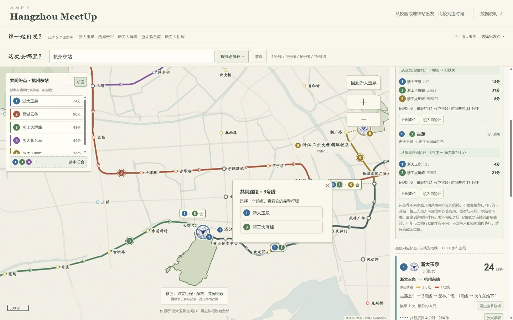

# Hangzhou MeetUp · 杭城同行

从不同校区或地铁站出发，在一张杭州都市圈轨道地图上比较到达时间、路线和途中汇合点。适用于日常出行、通勤、地点选择和多起点同行。

这是独立 Node.js 源码发行版，**无需 ChatGPT、Codex、Python 或第三方 npm 包**。每位下载者在自己的电脑或服务器中配置自己的高德 Web 服务 Key，项目不附带开发者 Key，也不会调用开发者的托管网站。

本项目演示及第三方服务接入示例仅供个人学习、研究与技术交流参考；校徽仅用于地点识别，不代表学校背书。请先阅读 [个人学习用途与第三方资源声明](DISCLAIMER.md)。原创代码的 MIT 许可与第三方资源的许可分别适用。



## 功能

- 支持浙江大学、浙江工业大学、西湖大学的 10 个独立校区；海宁国际校区排在浙大列表最后。
- 自选校门，选择步行、公交、骑行或打车接驳；可添加具体运营地铁站为出发点。
- 按站名或线路选择目的地，也可点地图查询；比较整数分钟估时及路线拆分。
- 杭州地铁、杭海城际及相连的绍兴线路；东站两个站区合并选择，跨站区步行计时。
- 多起点编号、路线聚焦、重叠区间合并、方向箭头，以及“不同来路汇入同向共同路段”的途中汇合建议。
- 校园范围、随缩放出现的校门/站名、电脑和手机响应式布局。

站点目录与底图是发行快照，服务查询仍需联网。时间是静态规划估计，不是实时列车到站时间。

## 5 分钟运行

安装 [Node.js](https://nodejs.org/) **22.13 或更新版本**。解压本项目，进入包含 `server.mjs` 和 `package.json` 的目录。

```sh
npm run setup
```

这会创建空白 `.env`，已有文件不会被覆盖。用文本编辑器填写自己的 Key：

```dotenv
AMAP_WEB_SERVICE_KEY=在这里填写自己的高德Web服务Key
HOST=127.0.0.1
PORT=8080
```

将中文提示替换为真实 Key，保存后：

```sh
npm run doctor
npm start
```

浏览器打开 **http://localhost:8080**，保持终端开启。无需运行 `npm install`。Windows 也可双击 `启动地图.cmd`，首次运行会创建并打开配置文件。

`doctor` 只检查文件与是否填入配置，不验证高德账户、Key 权限或余额；不会显示 Key，也不消耗接口调用量。修改 `.env` 后需要重启服务。若系统已有同名环境变量，Node 会优先使用系统环境变量，请避免与 `.env` 冲突。

高德 Key 申请、手机访问、云服务器部署及常见报错，见 [配置指南](docs/CONFIGURATION.md)。

## 用户和 Key 的关系

- 每个独立部署只读取该电脑/服务器自己的 `AMAP_WEB_SERVICE_KEY`。
- 网页访客不需要在浏览器输入 Key；同一部署的访客共用部署者的接口额度。
- Key 只由后端发往高德 API，不写入页面、截图、浏览器本地存储或公开接口响应。
- `.env.example` 是可上传的空白模板；真实 `.env` 已被 `.gitignore` 排除。
- 没有 Key 时仍能浏览内置地图，一些站到站查询可用；学校接驳、任意选点末段步行等遇到无缓存数据时会明确失败，不补成虚构的完整时间。

## 使用步骤

1. 展开“谁一起出发”，选择校区或添加地铁站；按需设置校门及接驳方式。
2. 设置一个主起点，左栏显示它到交通枢纽的大致时间。
3. 搜索共同目的地地铁站，或在地图上选点。
4. 点击起点编号、路线或结果卡可聚焦；点“总览”恢复全部。
5. 打开“途中汇合”，查看谁与谁从哪个站开始同行。建议仅基于当前行程，不是寻找全城最优会面地点，也不自动改变原路线。

## 开发与测试

```sh
npm run build          # 从 src/ 和 data/ 重建 public/，不请求高德
npm test               # 不需要真实 Key，不调用在线供应商
npm run check:release  # 扫描发布文件与常见密钥特征
npm run pack:release   # 生成 releases/hangzhou-meetup-source.tar.gz
```

修改前端时编辑 `src/`，再构建并重启服务。`public/` 随仓库提交，保证下载后可直接启动；文件名带内容摘要，浏览器会加载新版本资源。

```text
src/             可编辑的 HTML、JS、CSS 与 Leaflet
data/            前端地理/线路快照与校徽（第三方素材）
config/          校区校门、站区连接、跨城模型、步行快照
lib/             查询、缓存、换乘与跨城路由
public/          构建后的网页资源，运行时直接提供
scripts/         初始化、构建、检查、打包
tests/           离线自动化测试
docs/            配置、架构与截图
server.mjs       独立 HTTP 服务
.env.example     空白环境变量模板
```

后端来源、缓存及更新时间口径见 [架构与数据说明](docs/ARCHITECTURE.md)。

## Docker

先创建并填写 `.env`，然后运行：

```sh
docker compose up -d --build
```

默认只将容器端口映射到本机 `127.0.0.1:8080`。公网部署需要支持 Node.js 或 Docker 的主机、HTTPS 和适当访问控制；Key 仍放在部署平台的服务器环境变量中。

**GitHub 仓库用于开源代码，不会自动变成可查询的网站。** GitHub Pages 只托管静态文件，不能运行此项目的 Node.js 后端或安全保存服务端 Key。[GitHub Pages 说明](https://docs.github.com/en/pages/getting-started-with-github-pages/what-is-github-pages)

## 时间和数据限制

- 杭州核心地铁优先使用 [OpenMetro](https://openmetro.dev)，学校接驳及末段路径按需使用高德；跨城段使用已整理的供应商规划快照。
- 从选定校门或站点参考位置起算，不包含校内步行、进出站、安检及铁路大厅内步行。杭州段不含候车；跨城段保留供应商固定预留项，不能称为实测候车。
- 打车不含叫车等待，骑行不含取还车；公交采用供应商方案总时间。
- 路线可能受到班次、运营变化、校门开放、天气等影响。无数据时标注未知，不用直线几何冒充实际路径。
- 初次访问需要加载数据。缓存能减少请求，但不能保证所有学校查询都不消耗高德额度；额度按接口调用量计，不是大模型 token。

## 开源与第三方资源

本项目原创程序代码及说明采用 [MIT](LICENSE)。Leaflet、OpenMetro 数据、OpenStreetMap 数据、高德派生快照和学校校徽具有各自权属，**不因代码 MIT 许可而获得统一再分发授权**。具体路径和来源见 [THIRD_PARTY_NOTICES.md](THIRD_PARTY_NOTICES.md)。

个人学习用途、自备 Key、校徽使用和权利反馈方式统一见 [DISCLAIMER.md](DISCLAIMER.md)。当前底图是 OpenStreetMap 数据由 Leaflet 绘制，高德提供轨迹及路径规划等补充资料；自备 Key 与包内既有快照的再分发许可是不同事项。

这个整理包包含用于复现当前地图的第三方数据及素材。校徽据作者说明下载自各学校官网“文化标识”等相关栏目，仅作学校和校区识别，遵循学校使用规范，不表示学校背书。高德派生轨迹及缓存的公开再分发授权仍需确认；公开发布相关资源前，应取得适用授权或换成允许再分发的数据。自备 Key、官网公开下载及个人学习用途均不使第三方资源自动转为 MIT 许可。

贡献及密钥处理见 [CONTRIBUTING.md](CONTRIBUTING.md) 与 [SECURITY.md](SECURITY.md)。
