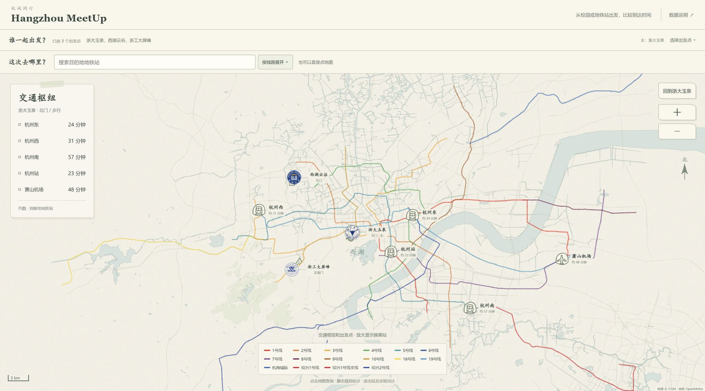
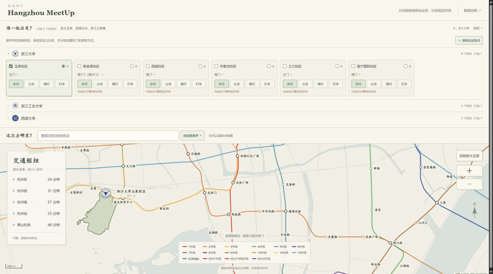
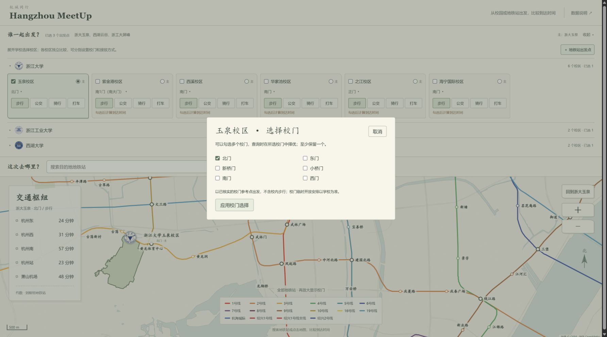
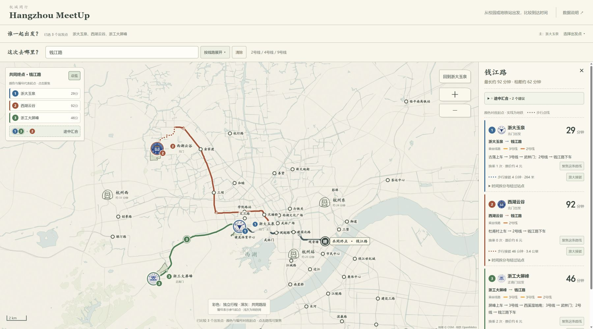
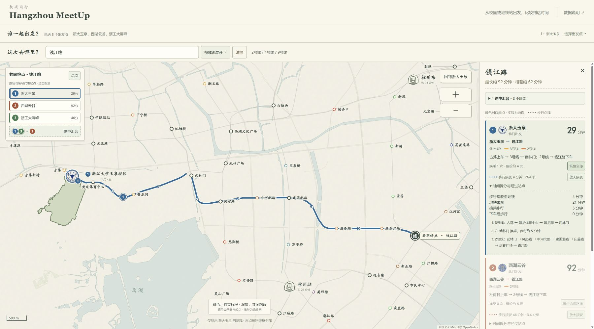
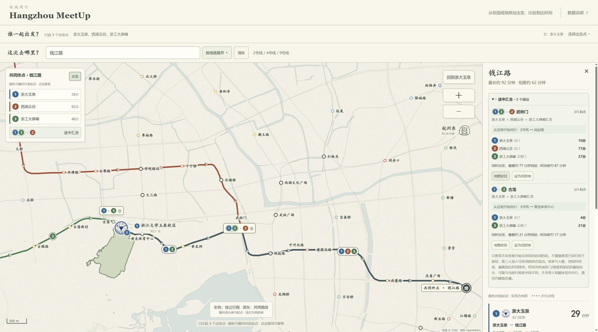
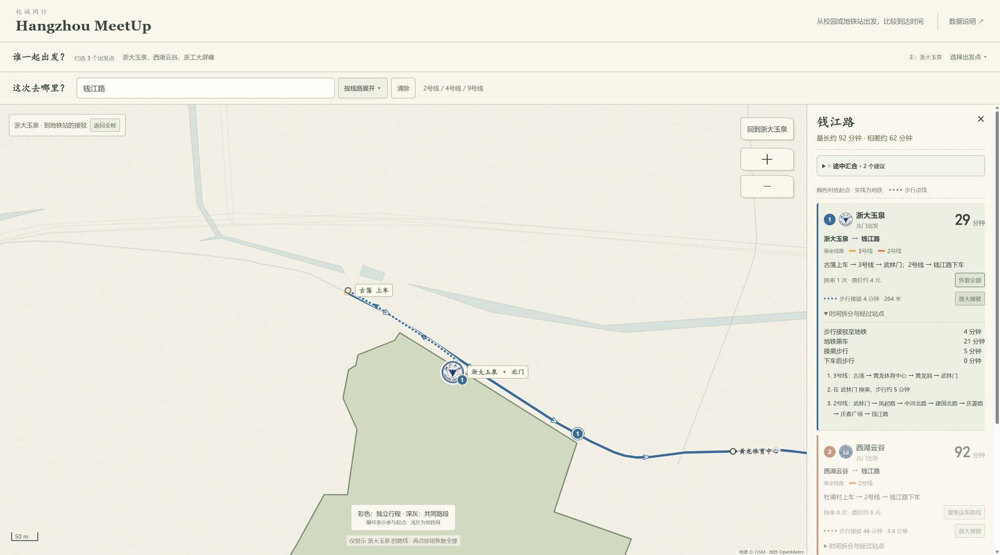
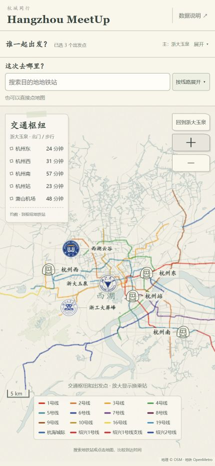

# 功能演示

[返回首页与下载入口](../README.md)

杭城同行把不同起点的路线放在一张杭州都市圈轨道地图上。你可以比较每天通勤要花多久，查看到车站的接驳，也可以和从不同地方出发的朋友找到途中会合的站点。

项目内置浙江大学、浙江工业大学和西湖大学的 10 个校区作为示例，包含浙大海宁国际校区。**这三所学校只是示例数据，下载后可以自行添加其他学校、校区和校门。** 当前需要编辑配置与数据文件，具体步骤见 [添加学校和校区](EXTENDING_CAMPUSES.md)。

左栏显示主出发点到交通枢纽地铁站的大致时间。缩小时看枢纽和出发点，放大后依次显示换乘站、普通站和校门。轨道范围包含杭州地铁、杭海城际以及相连的绍兴线路。

## 功能演示

### 约好到达时间，再看几点出发

主界面会显示当前北京时间。展开“到达时间与出发安排”，填写到达日期和时间，就能看到每个起点的建议出发时间。默认每人留 10 分钟途中缓冲、每处汇合留 3 分钟，都可以自己调整。

如果路线中有汇合点，面板还会列出各自几点到站、建议几点碰面，以及几点继续同行；有多个汇合点时会按先后关系安排。时间跨天会注明日期，建议出发时间已过也会提示。修改这些设置不会额外调用高德。

安排基于当前路线的累计耗时，不是实时班次。缺少逐站时间的汇合点会明确标注；首末班、校门开放及公交预约需另外确认。详情见 [更新日志](CHANGELOG.md)。

### 选择各自的出发点

展开学校名称，就能按校区勾选参与者。每个校区独立计算，还可以通过“＋ 地铁站出发点”添加具体运营站。设置一个主出发点后，左侧枢纽估时和地图回中位置会随之更新。下面以三所学校的现有数据演示；海宁国际校区放在浙江大学列表末尾。

### 选好校门，再决定怎么去地铁站

同一校区的不同校门，离地铁站的距离可能差不少。可以勾选一个或多个校门，让查询在选定的校门中比较路线；接驳方式由你选择，支持步行、公交、骑行和打车。学校行程从所选校门起算，地铁站出发点则从站内起算。

### 比较到同一个地方的行程

在搜索框输入站名，或按线路展开选择目的地。站名后会列出所属线路，换乘站用斜杠分隔。也可以直接点地图选位置。右侧逐一显示各起点的估时、换乘和票价；只有所有参与者都取得完整结果后，才会比较最长耗时和时间差。

图中选择了钱江路站。每条行程用起点编号和颜色对应，重叠的共同路段合并为深灰色，未使用的地铁网退到浅灰背景中。

### 单独看清一条路线

目的地下方的“路线偏好”可选择**时间优先**或**少换乘**。步行接驳优先附近的上车站，不为少换一次车而远走；少换乘最多多花10分钟，并限制额外站外步行。每张结果卡展示上车站、接驳时间、总耗时、换乘和票价，可单独切换。地图、途中汇合与建议出发时间随所选路线更新，偏好保存在本机。

杭州261个站的普通单程票价内置在程序中，直接按进出站查询；同一站间的时间优先和少换乘方案共用票价。站间路线也在本地计算，校门接驳和地图选点步行仍按需调用高德。票价不含公交、打车等接驳费用和个人优惠；未覆盖的跨区域区间、需要核实连续计费的出站换乘仍显示“待确认”。

前往**杭州东站**时，会显示“最多多花10分钟，优先1/4号线站区”的可选项，默认关闭。开启后，在完整行程不超过最快方案10分钟的候选中，优先乘地铁抵达1/4号线站区；先到东广场再步行过去不算此类便利方案。如果没有符合条件的路线，会保留当前偏好下的方案并说明原因。高铁大厅内步行、安检与候车需自行另留时间。

点击起点编号、路线或结果卡，可以聚焦某一条行程；点“总览”恢复全部。展开“时间拆分与经过站点”，能看到乘车、换乘步行和两端接驳分别花了多久。卡片中的线路色标保留地铁官方颜色，地图上的行程颜色用来区分不同起点。

### 在途中会合

“途中汇合”寻找的是不同来路开始共用同一方向路段的站点。图中，1 号和 3 号起点的行程先在古荡合流，再在武林门与 2 号行程会合。标识会直接显示参与者编号，面板里可以查看各自到站的估时，并定位建议站点。

这些建议基于当前目的地的行程，不是全城最优会面地点搜索。到站估时不包含等人和额外的站内步行，具体碰面位置还需要自行约定。

### 查看校门到地铁站的接驳

点击结果卡里的“放大接驳”，地图会放大到校门和上车站之间的路段。图中点线是实际查询得到的步行路径，实线是地铁；看完后可点“返回全程”。任意地图选点的查询还会计算下车后走到目的地的时间，缺少步行数据时会说明原因。

### 在手机上浏览

手机浏览器也能使用这张地图。窄屏下，路线结果放在地图下方，出发点选择可以折叠；电脑端则把比较结果放在右侧。局域网访问和服务器部署方法见 [配置指南](CONFIGURATION.md)。

截图中的时间来自示例校门、接驳方式和当次查询，仅用于演示操作，不是实时列车到站时间。
